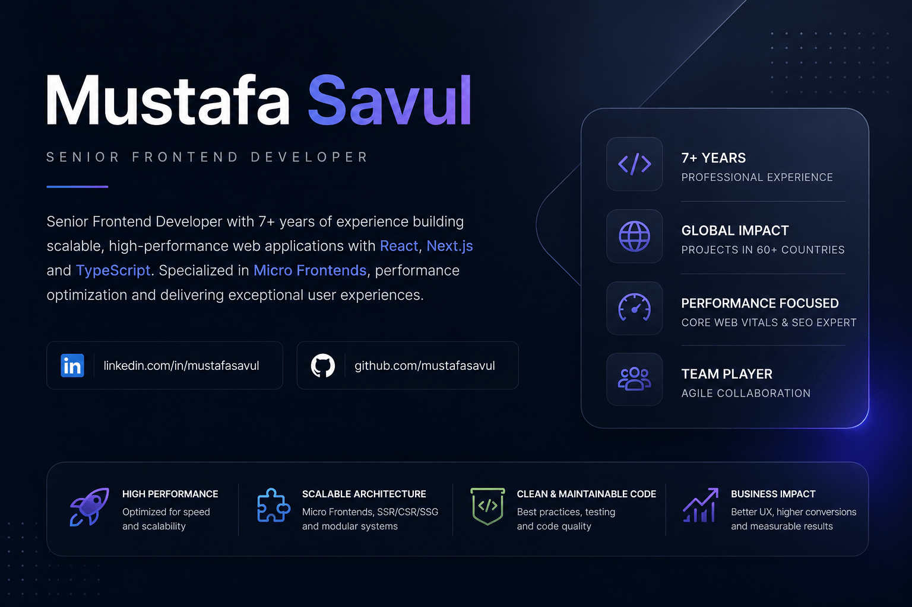

<h1 align="center">Hi, I'm Mustafa Savul 👋</h1>

<b>Senior Frontend Developer</b> · Istanbul, Turkey

---

## 👨‍💻 About

7+ years building scalable, high-performance web applications with **TypeScript, React and Next.js**. I've shipped e-commerce and enterprise platforms serving **millions of monthly visitors across 60+ countries**.

- 🏗️ Micro Frontend architecture — Module Federation, Lerna, monorepos
- ⚡ Rendering strategy & performance — SSR / CSR / SSG, Core Web Vitals, bundle budgets
- 🧪 Testing & CI/CD — Jest, React Testing Library, Playwright, GitLab CI, SonarQube
- 🤖 AI-assisted development — Claude Code, Cursor, MCP servers, agent workflows
- 🖥️ Cross-platform desktop apps with **Tauri + Rust**, mobile apps on the **App Store**

---

## 🛠️ Tech Stack

**Core**

**State · Data · UI**

**Build · Test · Quality**

**Architecture:** Micro Frontend (Module Federation, Lerna) · SSR / CSR / SSG · Design systems · Reusable component libraries 
**Performance & SEO:** Core Web Vitals (LCP, CLS, INP) · Code splitting · Bundle optimization · Technical SEO 
**Integration:** REST · GraphQL · .NET (MVC, Razor) · Amazon IVS · WebSockets

---

## 🤖 AI Tooling

How I actually work day to day — AI as a pair, not autocomplete.

- 🧩 **MCP servers** — wiring internal tools, docs and design sources into agent context
- 🪄 **Agentic workflows** — Claude Code subagents & skills for review, refactor and migration passes
- 📐 **Spec-first prompting** — plan, then generate; review diffs like any other PR
- 🔍 **AI-powered SEO (AIO)** — JSON-LD and structured content so LLMs can read the product too

---

## 💼 Experience

| Role | Company |
|---|---|
| Senior Frontend Developer | **LC Waikiki** (via NTT DATA Business Solutions) |
| Senior Frontend Developer | **Dgpays** |
| Frontend Developer | **Hepsiburada** (NASDAQ: HEPS) |
| Frontend Developer | **Crowdsol** |
| Frontend Developer | **Glomil Teknoloji** |
| Frontend Developer | **OGOO** |

**Selected impact**

- 🌍 Global storefront for a fashion retailer in **60+ countries**, multi-language & multi-currency — **~20% faster** page loads on high-traffic pages.
- 🧱 Multi-tenant enterprise platform on **Micro Frontend architecture**, letting 3+ teams deploy independently — **~30% smaller** initial bundle.
- 📈 **Core Web Vitals** on one of Turkey's largest marketplaces: LCP **-8%**, CLS below the 0.1 "good" threshold.
- 🧰 Shared library of **40+ reusable components** (Styled Components + Storybook), adopted across all product modules.
- ⚙️ GitLab CI pipelines + Jest coverage to **~60%** on core modules, **~25% faster** build & deploy.

---

## 🚀 Vibe Coding Projects

Evening projects that shipped. Open-source desktop tools and apps on the App Store.

<table>
<tr>
<td width="50%" valign="top">

### 🎡 [ClipWheel](https://github.com/mustafasavul/ClipWheel)
**Privacy-first radial clipboard manager**

A radial menu pops up under your cursor with your clipboard history — pick with a flick instead of scrolling a list. Everything stays local: no account, no sync, no telemetry.

`macOS` · `Windows` · `Linux` 
[⬇️ Download](https://github.com/mustafasavul/ClipWheel/releases) · [📦 Source](https://github.com/mustafasavul/ClipWheel)

</td>
<td width="50%" valign="top">

### 🔌 [portiye](https://github.com/mustafasavul/portiye)
**Find what's using a port — and stop it**

`EADDRINUSE :::3000` with four terminals open. portiye lives in the menu bar, shows every listening port, which process owns it and which project started it — then kills it in one click. Also manages Android emulators, iOS simulators, Docker containers and build daemons.

`macOS` · `Windows` · `Linux` · `28 languages` 
[⬇️ Download](https://github.com/mustafasavul/portiye/releases) · [📦 Source](https://github.com/mustafasavul/portiye)

</td>
</tr>
<tr>
<td width="50%" valign="top">

###  [Animal Sounds & Calls](https://apps.apple.com/us/app/animal-sounds-calls/id6772835297)
**Playful animal sounds & pretend calls for kids**

Kids tap animals to hear real sounds, get surprise "calls" from them, take sound quizzes, save favorites and learn simple facts about farm, jungle, forest, ocean and zoo animals.

[🍏 App Store](https://apps.apple.com/us/app/animal-sounds-calls/id6772835297)

</td>
<td width="50%" valign="top">

###  [Mythobase](https://apps.apple.com/us/app/mythobase-discover-mythology/id6743084078)
**Discover mythology — 23 mythologies in one app**

Thousands of gods, heroes, creatures and legendary weapons, from Zeus's thunder to Odin's ravens and Turkic sky-gods — with original artwork for every entry.

[🍏 App Store](https://apps.apple.com/us/app/mythobase-discover-mythology/id6743084078)

</td>
</tr>
<tr>
<td width="50%" valign="top">

### 🏔️ [Mountainverse](https://mountainverse.mustafasavul.com)
**The world's mountains in 3D — built from real satellite data**

120 famous mountains, from Everest to Olympus Mons on Mars, rebuilt as 3D models from satellite imagery and elevation data. Spin them, follow climbing routes, check live summit weather, compare heights and place them on your table in AR.

`3D` · `AR` · `Copernicus & Sentinel-2 data` 
[🌐 Website](https://mountainverse.mustafasavul.com) · 🍏 App Store — coming soon

</td>
<td width="50%" valign="top">
</td>
</tr>
</table>

---

## 📊 GitHub

---

🎓 BSc Management Information Systems, Anadolu University · Associate Degree in Computer Programming, Istanbul Topkapi University 
🌍 Turkish (native) · English (advanced) 
📫 Reach me on <a href="https://www.linkedin.com/in/mustafasavul">LinkedIn</a>

